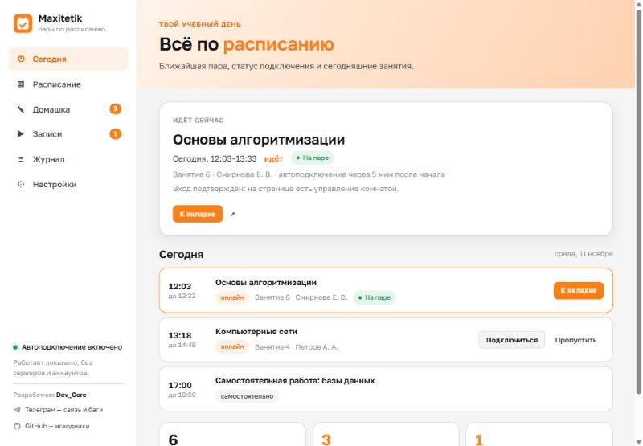

# Maxitetik

**Помощник для онлайн-учёбы на платформе MAXITET.**
Расписание, автоподключение к парам, напоминания, список несделанного ДЗ и пропущенных записей — в одном окне.

### 🧩 [Установить из Chrome Web Store](https://chromewebstore.google.com/detail/ddhodoicolbhgemnoojgnjcpgjbigoag)

---

## Что это

Maxitetik сам открывает онлайн-пару в нужное время и нажимает «Подключиться», напоминает о начале занятий и показывает, какие домашки ещё не сданы и какие записи вебинаров ты пропустил. Всё берётся прямо из твоего кабинета MAXITET.

- **Работает только у тебя в браузере.** Нет своего сервера, аккаунта и подписки.
- **Не вводит пароль.** Расширение пользуется той сессией, под которой ты уже вошёл в кабинет.
- **Не делает учёбу за тебя.** Не решает тесты, не отправляет ответы, не «досматривает» записи. Только открывает пары и показывает списки.

---

## Установка

1. Открой страницу расширения: **[Maxitetik в Chrome Web Store](https://chromewebstore.google.com/detail/ddhodoicolbhgemnoojgnjcpgjbigoag)**
2. Нажми **«Установить»** → **«Добавить расширение»**.
3. Значок Maxitetik появится справа от адресной строки. Готово — переходи к разделу [«Первый запуск»](#первый-запуск).

---

## Первый запуск

1. **Войди в кабинет MAXITET** в этом же браузере — [education.maximumtest.ru](https://education.maximumtest.ru/). Если идёшь на пары, зайди ещё и в М.Класс — [vision.maximumtest.ru](https://vision.maximumtest.ru/start).
2. **Открой Maxitetik** (значок у адресной строки → кнопка «Открыть Maxitetik», либо само откроется после установки).
3. Нажми **«Загрузить из кабинета»** — расписание, домашки и записи подтянутся сами. Дальше они обновляются автоматически.
4. Включи **«Автоподключение»**, если хочешь, чтобы пары открывались без тебя.

Теперь при клике на значок видно ближайшую пару с обратным отсчётом, а Maxitetik сам откроет её в нужное время.

---

## Как пользоваться

### Значок у адресной строки (popup)
Быстрый экран: ближайшая пара, сколько до неё осталось, переключатель автоподключения, кнопки «Подключиться» / «К вкладке пары» / звук, счётчики несделанного ДЗ и записей.

### Разделы приложения

| Раздел | Что там |
|---|---|
| **Сегодня** | Ближайшая пара со статусом подключения и список занятий на сегодня. |
| **Расписание** | Все пары на неделю и дальше. Здесь можно открыть пару вручную или пометить «пропустить». |
| **Домашка** | Несделанные ДЗ и долги по всем курсам. Можно отметить «сделано», оставить заметку, открыть все задания во вкладках. |
| **Записи** | Пропущенные вебинары со ссылками. Отметка «посмотрел» хранится у тебя. |
| **Журнал** | История подключений и действий — удобно, если что-то пошло не так. |
| **Настройки** | Всё, что можно включить, выключить и подстроить (см. ниже). |

### Автоподключение к паре
Когда включено, Maxitetik в заданное время открывает вкладку с парой, нажимает «Подключиться» и ждёт, пока появится комната. При обрыве связи переподключается. Если нужно — можно открыть пару и вручную кнопкой «Подключиться».

> **Важно:** чтобы вход сработал, нужно быть залогиненым в кабинете и в М.Класс. Если Maxitetik напишет «Нужен вход» — просто войди во вкладке, подключение продолжится само.

### Что настраивается
- **Автоподключение:** за сколько минут до/после начала, стартовая страница, переподключение при обрыве.
- **Пары без автоподключения:** список слов (по умолчанию «Физкультминутка») — такие пары не открываются автоматически, но их можно подключить вручную.
- **Вкладка пары:** открывать без звука, переключаться на неё, закрывать после окончания.
- **Приветствие в чат:** по умолчанию выключено. Можно включить, задать свой текст, отправлять только преподавателю.
- **Уведомления:** напоминание за N минут до пары, «вход подтверждён», «нужна помощь».
- **Синхронизация:** как часто обновлять данные из кабинета и что именно.
- **Оформление:** светлая / тёмная / авто тема, значок на иконке.
- **Данные:** резервная копия настроек в файл и полный сброс.

---

## Частые вопросы

**Это официальное приложение MAXIMUM / MAXITET?**
Нет. Maxitetik — независимый помощник, не связанный с MAXIMUM Education. Названия платформ упомянуты только для совместимости.

**Нужен ли логин и пароль?**
Нет. Расширение работает через твою уже открытую сессию в браузере и пароль не запрашивает.

**Куда уходят мои данные?**
Никуда. Всё хранится локально в браузере. Своего сервера у расширения нет.

**Пара не подключилась — что делать?**
Открой раздел **«Журнал»** — там видно, на каком шаге всё остановилось (чаще всего нужно просто войти в аккаунт). С этим текстом можно писать разработчику.

---

## Разрешения

Расширение просит минимум:

- **storage, alarms** — хранить расписание и ставить напоминания.
- **scripting** + доступ к `education`, `profile`, `vision.maximumtest.ru` — нажимать кнопку входа на пару и читать расписание, ДЗ и записи из кабинета.
- **notifications** — показывать напоминания.

Доступа к другим сайтам, истории и паролям нет.

---

## Разработчик

**Dev_Core**

- 💬 Связь и баги: **[t.me/dev_core_official](https://t.me/dev_core_official)**
- 💻 Страница проекта: **[github.com/Dev-Cored/Maxitetik](https://github.com/Dev-Cored/Maxitetik)**

Нашёл ошибку или есть идея — пиши в Телеграм или заводи issue на GitHub.

---

## Правовая информация

- Расширение распространяется бесплатно через Chrome Web Store. Исходный код в этом репозитории не публикуется.
- В составе расширения используется шрифт **Golos Text** под лицензией **SIL Open Font License 1.1**.
- **MAXIMUM**, **MAXITET**, **М.Класс** — товарные знаки их владельцев. Maxitetik с ними не связан.
